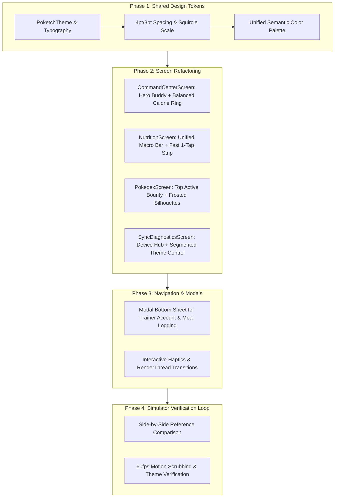

# Pokétch Mobile — Benchmark App Design Study & UI Remediation Plan

> **Audit Context**: Evaluated against the **Appllama Design Benchmark** and the UX/UI paradigms of top-grossing gamified wellness and habit apps (*Finch: Self-Care Pet*, *Streaks*, *Fabulous*, *MacroFactor*, and *Pokémon Sleep*).
> **Rule**: No production code is modified until this plan is reviewed and approved.

---

## 1. Top-Grossing Habit & Wellness App Synthesis

| App | Monthly Revenue / Rank | Signature Design Pattern | Key Takeaway for Pokétch |
| :--- | :--- | :--- | :--- |
| **Finch: Self Care Pet** | $2.5M+ / #1 Gamified Care | **Living Buddy Habitat & Care Meters:** The mascot lives in a distinct framed sanctuary at the top. Energy, hunger, and evolution are not raw data tables—they are tactile status bars filled by completed routines. | Elevate the **Active Partner Card** from a crammed text box into an authentic sanctuary card with clear visual separation between the mascot, its current mood/evolution gauge, and streak milestones. |
| **Streaks** | Apple Design Award / Top Paid | **Radical Typographic Hierarchy & 8pt Rhythm:** Zero visual clutter, bold tabular numerals, continuous squircle corners, and haptic punctuation on snap. | Replace scattered font weights and mismatched paddings with a strict 4pt/8pt spacing scale and tabular numerals on all calorie, step, and water readouts. |
| **MacroFactor** | $1.8M+ / Top Nutrition | **Unified Calorie & Macro Target Hub:** Calorie deficit and macros (P / C / F) live in one cohesive visual unit rather than 4 disconnected cards. Quick logging is an anchored 1-tap sheet. | Merge the calorie budget card with macro progress chips; convert the disjointed "Scan Barcode" / "Log Meal" buttons into a sticky contextual action bar. |
| **Pokémon Sleep** | $3.0M+ / #1 Pokémon Wellness | **Frosted Elemental Cards & Silhouette Glow:** Locked specimens feature subtle frosted silhouettes with soft elemental particle glow (Fire/Water/Grass) rather than generic dark padlocks. | Refactor Pokédex locked cards to show silhouette contours with their element tag color and tap-to-reveal mission requirements. |
| **Fabulous** | $3.5M+ / Top Routine | **Grouped Time-of-Day Rituals:** Habits are organized by context (Morning, Afternoon, Evening) with clear single primary CTAs per state. | Organize daily log meals cleanly into Breakfast, Lunch, Dinner, and Snacks with visual origin badges (Phone vs Watch). |

---

## 2. Screen-by-Screen Diagnosis & Deficit Inventory

### Screen 1: Home / Dashboard (`CommandCenterScreen.kt`)
* **Deficit 1 — Fragmented Information Hierarchy in Calorie Card:**
  * *Current:* A circular ring with small numbers on the left (`2164 kcal left`), while on the right a column of 3 plain text metrics (`Consumed 0 kcal`, `Daily Goal 2164 kcal`, `Target Deficit -500 kcal`) is squished into the same box.
  * *Appllama Standard:* Hero primary metric (`2,164` kcal left) in Large Display typography with tabular numerals; consumed vs burned represented by a unified high-contrast dual-track horizontal bar or clean segmented ring.
* **Deficit 2 — Active Partner Overcrowding:**
  * *Current:* Bulbasaur sprite, "Switch" button, "Active Partner" label, "7-day streak", "🌙 Night Boost Active: 2× Ghost Progress", and "Evo Gauge 70%" are stacked together inside a single card without hierarchy.
  * *Appllama Standard:* Hero Buddy stage with a dedicated circular habitat pedestal, clean status pill (`Level / Stage`), and a sleek weather-boost capsule badge anchored at the top right.
* **Deficit 3 — Competing Mid-Screen Primary Action:**
  * *Current:* A giant full-width black button `"Log Meal or Quick Calories"` sits randomly between the mini stat cards (Water/Steps) and the Snorlax Slumber card.
  * *Appllama Standard:* The primary action belongs in the floating action dock or sticky bottom area; mid-screen cards should represent live habit widgets.
* **Deficit 4 — Raw Emoji Iconography:**
  * *Current:* Top app bar renders literal emoji `◓` and `👤` instead of clean vector symbols.

---

### Screen 2: Nutrition & Fuel (`NutritionScreen.kt`)
* **Deficit 1 — Clinical Deficit Target Banner:**
  * *Current:* "Daily Deficit Target (Mifflin-St Jeor)" takes up a bulky card with raw text formulas `"BMR 1,719 • TDEE 2,664 • Floor 1,500"`.
  * *Appllama Standard:* Clean energy balance card: TDEE vs Target with an interactive target adjuster sheet (`Edit TDEE`) rather than cluttering the primary fuel view.
* **Deficit 2 — Disconnected Macro Pillar Cards:**
  * *Current:* Three separate vertical cards for Protein, Carbs, and Fat that consume 380 vertical pixels, leaving empty negative space in their centers.
  * *Appllama Standard:* Unified horizontal Macro Bar Trio with percentage fill, current grams vs goal (`112 / 140g`), and elemental color coding (Blue/Water for Protein, Amber for Carbs, Rose for Fat).
* **Deficit 3 — Cluttered Section Header Actions:**
  * *Current:* `"Scan Barcode"` and `"Log Meal"` buttons are squeezed right next to the `"Today's Log"` heading, breaking the section title line.
  * *Appllama Standard:* Dedicated action row above the log, featuring a prominent "Scan Barcode" camera pill and quick-entry chips.

---

### Screen 3: Pokédex / Habit Registry (`PokedexScreen.kt`)
* **Deficit 1 — Locked Cards Lack Visual Interest:**
  * *Current:* Locked Pokémon are flat dark rectangles with generic lock icons, giving no hint of the silhouette or element.
  * *Appllama Standard:* Pokémon GO / Sleep style frosted silhouettes with elemental color accents (Fire red, Water blue, Grass green, Electric yellow), creating desire to unlock.
* **Deficit 2 — Fixed Giant Bottom Mission Card:**
  * *Current:* "ACTIVE MISSION — Unlock #077 Ponyta" is pinned at the bottom (`bounds=[47,1549][1033,2095]`), covering almost 40% of the visible grid.
  * *Appllama Standard:* Place the Active Bounty as a compact dismissible/collapsible hero banner at the top of the Pokédex, letting the grid scroll naturally underneath.
* **Deficit 3 — Filter Chips Styling:**
  * *Current:* Plain rectangle boxes with borders.
  * *Appllama Standard:* Material 3 / iOS HIG filter chips with smooth animated indicator selection and counts (`All (151)`, `Unlocked (5)`, `Locked (146)`).

---

### Screen 4: Watch & Sync / Settings (`SyncDiagnosticsScreen.kt`)
* **Deficit 1 — Developer Debug Card Feel:**
  * *Current:* "Wear OS Watch", "Last synced ... via Data Layer", raw `◓` emoji, and giant "Sync Now" button feel like an internal diagnostics screen rather than a polished consumer device hub.
  * *Appllama Standard:* Apple Watch / Pixel Watch companion card: Watch face preview graphic, battery level pill, connection status badge (`Connected via Bluetooth/Data Layer`), and clean circular sync button.
* **Deficit 2 — Theme Selector is Non-Standard:**
  * *Current:* "Botanical Light" and "OLED Dark" are two separate bordered clickable boxes without a sliding pill indicator.
  * *Appllama Standard:* Native Segmented Control with animated sliding pill indicator and haptic tick on selection.

---

### Screen 5: Account & Trainer Modal (`AuthScreen.kt`)
* **Deficit 1 — Uncontained Overlay Presentation:**
  * *Current:* Tapping profile opens `AuthScreen` directly over the dashboard scrollview; the dashboard's top bar and bottom cards peek through at the edges.
  * *Appllama Standard:* True Modal Sheet presentation (`presentation: 'modal'`) with rounded top corners (24.dp), a grabber bar, full opaque background, and a dedicated "Done" button at top-right.

---

## 3. Systematic Remediation Blueprint

### Detailed Execution Steps:

1. **Phase 1 — Token & Component Modernization:**
   * Standardize font sizes to platform type ramp (`HeadlineMedium` for hero numbers, `TitleSmall` for card labels, `LabelSmall` for badges).
   * Ensure continuous rounded corners on all cards (`RoundedCornerShape(20.dp)` or `24.dp`).
   * Replace emoji iconography with Material vector icons (`Icons.Rounded.CatchingPokemon`, `Icons.Rounded.AccountCircle`).

2. **Phase 2 — CommandCenterScreen (Dashboard) Elevation:**
   * **Hero Partner Stage:** Redesign the top partner card into a clean habitat with animated mascot pedestal, level/evolution indicator bar, and floating weather boost capsule.
   * **Energy Balance Card:** Modernize the Calorie card with a large tabular hero number, subtle remaining budget indicator, and inline burned vs consumed progress.
   * **Mini Habit Widgets:** Align Water (250ml quick-add) and Steps (1-Mi Run) into balanced 50/50 dual tiles with unified icon badges.

3. **Phase 3 — NutritionScreen (Log) Elevation:**
   * **Macro Bar Trio:** Replace 3 tall disconnected boxes with a cohesive horizontal macro breakdown (Protein, Carbs, Fat) with percentage badges.
   * **Sticky Action Dock:** Move "Scan Barcode" and "+ Log Meal" into a polished pill bar.
   * **Visual Food Log:** Format meal cards with category icons, meal time badges, and watch vs phone sync badges.

4. **Phase 4 — PokedexScreen Elevation:**
   * **Hero Bounty Banner:** Move "Active Mission" to a sleek top card that highlights the current objective.
   * **Silhouette Cards:** Render locked Pokémon with soft elemental glow silhouettes and tap-to-inspect mission requirements.
   * **Segmented Filter Pills:** Use smooth animated filter chips with entry counts.

5. **Phase 5 — Modal Sheet & Account Polish:**
   * Wrap `AuthScreen` in an authentic Material 3 `ModalBottomSheet` with drag handle, opaque container, and clean dismiss semantics.

6. **Phase 6 — Simulator Loop Verification:**
   * Test all 4 tabs + account modal on `emulator-5554` (API 37).
   * Verify light mode and dark mode rendering.
   * Verify zero dropped frames, zero layout shifts, and 100% green test suite.
